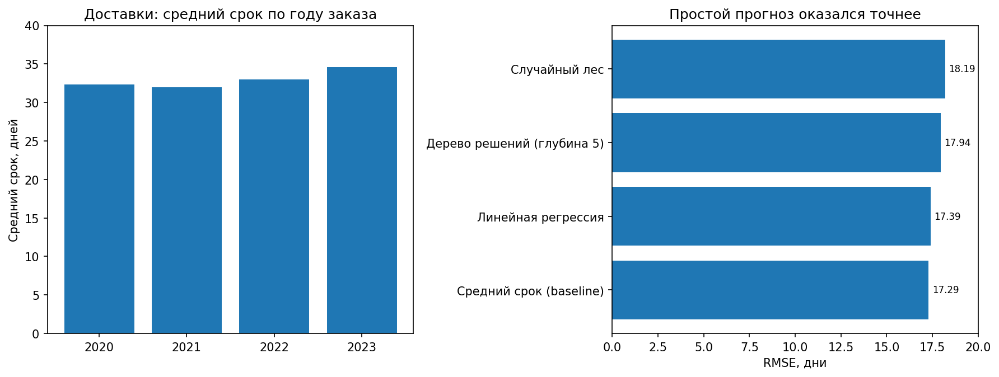
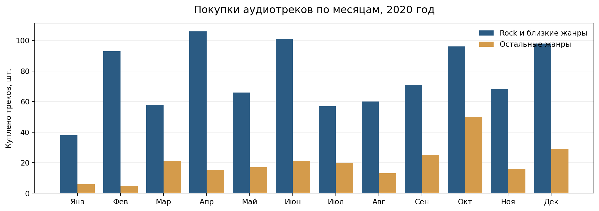

# Анализ заказов, доставки продуктов и продаж музыки

В репозитории представлены три исследования на данных двух независимых сервисов:

- **Доставка продуктов:** анализ заказов, спроса, покупательской активности и выполнения доставок.
- **Прогноз сроков доставки:** оценка качества данных и сравнение моделей на уровне отдельных заказов.
- **Музыкальный магазин Chinook:** структура продаж по жанрам и динамика покупок в 2020 году.

## 1. Заказы и доставки продуктов

Исследование охватывает несколько направлений работы сервиса: товарный спрос и совместные покупки, число выполненных и незавершённых доставок, распределение заказов по способам оплаты, активность клиентов и продолжительность сессий в приложении.

Для этих задач подготовлены аналитические выборки из таблиц заказов, товаров, покупателей и доставок. В частности, исследуются самые востребованные товары, даты максимальной и минимальной нагрузки на доставку, популярные товарные категории в возрастных группах и сочетания товаров в одном заказе.

[Анализ заказов и доставок – SQL](ecommerce_analysis.sql)

## 2. Прогнозирование сроков доставки

**Задача:** проверить, насколько точно можно прогнозировать срок доставки по характеристикам заказа: способу оплаты, количеству товаров, числу товарных позиций и стоимости корзины.

При подготовке данных выявлены **282 заказа с несколькими различными датами доставки**. Из них 250 вошли в итоговую выборку из **1 046 заказов**. Это существенно влияет на целевую переменную: если принимать последнюю указанную дату, средний срок составляет **32,67 дня**, а при выборе первой – **27,59 дня**.

Модели сравнивались на одинаковых разбиениях с помощью пятикратной кросс-валидации. Критерий качества – RMSE в днях: чем меньше, тем точнее прогноз.

| Подход | RMSE, дней |
|---|---:|
| **Прогноз средним значением** | **17,29** |
| Линейная регрессия | 17,39 |
| Дерево решений | 17,94 |
| Случайный лес | 18,19 |

**Результат:** ни одна из моделей не превзошла базовый прогноз средним сроком. Характеристик корзины и способа оплаты оказалось недостаточно, чтобы надёжно предсказывать доставку. Для дальнейшей работы требуется уточнить смысл повторяющихся дат и дополнить данные логистическими признаками – расстоянием, загруженностью курьеров, маршрутом и доступностью товаров.

[Исследование и расчёты – Jupyter Notebook](delivery_forecast.ipynb) · [Интерактивный дашборд](delivery_dashboard.html)

## 3. Продажи музыкального магазина Chinook

**Задача:** проанализировать покупки аудиотреков за 2020 год, сравнить группу `rock` (включая близкие жанры) с остальными жанрами и исследовать помесячную динамику продаж.

| Показатель за 2020 год | Rock | Остальные жанры |
|---|---:|---:|
| Продано аудиотреков | **912** | 238 |
| Доля проданных аудиотреков | **79,3%** | 20,7% |
| Чеков с покупками группы | 141 | 83 |
| Уникальных покупателей группы | 57 | 49 |
| Сумма покупок | 902,88 | 235,62 |

Покупки `rock` преобладали во все месяцы 2020 года. Наибольшее число проданных треков этой группы пришлось на **апрель (106)**, а остальных жанров – на **октябрь (50)**. Эти различия отражают колебания спроса в пределах года; для подтверждения сезонности необходимо проследить динамику за несколько лет.

Чеки и покупатели посчитаны отдельно для каждой группы: один человек или чек может относиться к обеим категориям.

[Анализ продаж – Jupyter Notebook](music_sales.ipynb)

## Материалы

| Файл | Содержание |
|---|---|
| [`ecommerce_analysis.sql`](ecommerce_analysis.sql) | Заказы, клиенты, товарный спрос и выполнение доставок |
| [`delivery_forecast.ipynb`](delivery_forecast.ipynb) | Качество данных, подготовка признаков и оценка прогнозов |
| [`delivery_dashboard.html`](delivery_dashboard.html) | Интерактивная визуализация сроков доставки и ошибок моделей |
| [`music_sales.ipynb`](music_sales.ipynb) | Продажи аудиотреков: жанры, покупатели, чеки, выручка и динамика |
| `delivery.csv`, `orders_products.csv` | Данные для исследования доставки |
| `chinook.db` | База музыкального магазина для воспроизведения расчётов |

Ноутбуки можно открыть в Jupyter Notebook: используемые файлы данных расположены в корне репозитория. SQL-анализ заказов рассчитан на отдельную реляционную базу сервиса доставки, которой нет в этом комплекте; поэтому неподтверждённые численные результаты по этой части не приводятся.
